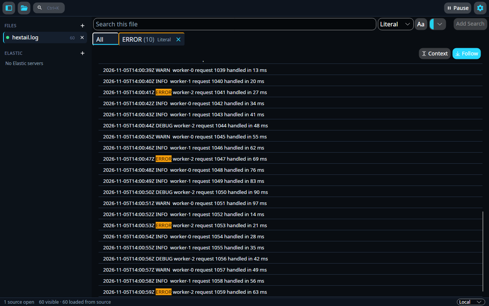

# HexTail


HexTail is a native cross-platform desktop application for watching live log
files. It opens plaintext, `.logfmt`, and `.jsonl` files, keeps multiple files and
searches in separate tabs, and renders a bounded, virtualized log view without
a browser, WebView, JavaScript runtime, or local HTTP server.

Elastic sources use separate Kibana and Elasticsearch URLs, a stepped setup
flow (connection, data view, filter, columns, name) with an automatic
connection test and live document counts, ordered output fields, a five-minute
initial lookback, and native OS credential storage for authenticated
connections.



## Features

- Live tailing with append, truncate, rotation, and missing-file recovery.
- Multiple files listed in a source sidebar, opened from the native picker,
  drag-and-drop, or the command line.
- A filter bar for every source: Enter highlights, Shift+Enter shows only
  matching rows, Alt+Enter hides them. Each rule is a chip (dashed for global
  rules, solid for one source) that you click to edit, middle-click to disable
  or remove; literal or regex, optional case sensitivity, an automatic color.
- A T/D/I/W/E log level control per source.
- Merged streams: combine two or more open sources (files and Elastic) into a
  named stream whose rows are interleaved by timestamp, with a Source column,
  a colour stripe per source, per-source toggles, and one time range for the
  whole stream.
- Named saved filters, applied from the sidebar or the command palette.
- Search tabs (Pin as tab) with a separate highlight color for each search.
- Independent follow-tail toggles for the All view and each search view.
- Timestamps for log lines: read from well-known fields, ISO-8601, common-log
  and syslog prefixes (or the Elastic document), with lines such as stack
  traces inheriting the entry above them.
- Columns for structured sources (JSONL, logfmt, Elastic): Time, Level and
  Message by default, with a resizable header, a **Columns** menu for more
  fields, absolute or relative time, level colours and a tinted error row.
- A row inspector (`Ctrl+I`): raw text, parsed fields you can turn into
  show-only, hide or highlight rules, copy, or add as a column, **Copy raw**
  and **Copy JSON**, an optional **Show context** list of neighbouring rows,
  and a bookmark toggle.
- Session bookmarks: `m` marks the selected row, `]` and `[` jump between
  bookmarked rows. Bookmarks are not saved.
- Global rules: make any rule apply to every source with the chip's **All
  sources** switch.
- Display density, log font size, and theme settings, plus **Limits** for the
  line cap per source, context lines and the initial Elastic fetch.
- Session persistence for open files, streams, searches, settings, window
  geometry, and the inspector's open state and width.

## Quick start

### Install from NuGet

Use the .NET 10 SDK to install HexTail as a global tool. Release packages
include the .NET runtime for Windows x64, Linux x64, and macOS x64/arm64.

```bash
dotnet tool install --global HexTail
hextail /path/to/application.log
```

### Portable downloads

GitHub releases also include self-contained ZIPs for `linux-x64`, `win-x64`,
`osx-x64`, and `osx-arm64`. Extract the ZIP and launch HexTail; no .NET
installation is required.

### Run from source

Requires the .NET 10 SDK.

```bash
dotnet restore src/HexTail.slnx
dotnet run --project src/HexTail/HexTail.csproj -- /path/to/application.log
```

You can also start without a path and use **Open**, drag files onto the window,
or pass multiple paths:

```bash
dotnet run --project src/HexTail/HexTail.csproj -- \
  /var/log/application.log /var/log/worker.log
```

## Generate test logs for development

Generate a continuously appended plaintext log for a live tailing session:

```bash
dotnet run --project src/HexTail.LogGenerator -- --output /tmp/hextail.log --interval 250 --truncate
```

Press `Ctrl+C` to stop it. Generate exactly 100 JSONL records instead:

```bash
dotnet run --project src/HexTail.LogGenerator -- --format jsonl --output /tmp/hextail.jsonl --count 100 --truncate
```

## Using HexTail

1. Open one or more files with the folder button, `Ctrl+O`/`Cmd+O`, or
   drag-and-drop. With nothing open, the empty state also offers recent files
   and Elastic sources, **Connect to Elastic**, and **Try a sample log**, a
   generated log that is kept out of the saved session and the recents list.
2. Pick a source in the sidebar, which lists open files and Elastic sources.
   Each source has an **All** view with the complete buffered tail. The
   **STREAMS** section above **Files** lists merged streams (see below). Toggle the
   sidebar with the toolbar button or `Ctrl+B`; below 1000 px wide it becomes an
   overlay that closes after a selection.
3. Type in the filter bar under the view tabs: Enter highlights matches,
   Shift+Enter shows only matching rows, Alt+Enter hides them. Turn on **Pin as
   tab** first to make Enter add a search tab instead; tabs show matching
   lines while the All view highlights the same matches.
   JSONL, logfmt and Elastic sources show Time, Level and Message columns
   under a header you can drag to resize; the **Columns** menu at its right end
   adds fields, switches between absolute and relative time, composes rows
   back into one line, or resets the layout.
4. **Follow** is on each view's toolbar. Follow keeps a view at
   the newest line or match; scrolling away shows a **↓ N new lines** pill that
   jumps back and resumes following. Press `Ctrl+I`, Enter on a row, or
   double-click a row to open the **inspector** for it; `m` bookmarks the
   selected row. **Pause** on the top toolbar freezes row updates in
   the view while logs keep buffering.
5. The status bar shows source and row counts and the display time zone
   (**Local** or **Utc**). For an Elastic source, the clock pill in the top
   toolbar (for example **Last 5 min · live**) opens the time range: quick
   presets, or typed **From** and **To** times.
6. To merge sources, press **+** next to **STREAMS** in the sidebar, name the
   stream, tick at least two open sources and **Save**. The stream opens as a tab
   of its own whose rows from all its sources are interleaved by timestamp, each
   with a Source column and a coloured stripe. A chip per source in its filter
   bar hides or shows that source, and the time pill applies one range to the
   whole stream. The pencil next to a stream edits or deletes it; closing a
   stream keeps its definition. See the
   [user guide](docs/user-guide.md#streams) for ordering, late rows and the
   time range.
7. Press `Ctrl+K` for the command palette. **Set up Elastic** (the sidebar's
   Elastic **+**, **Connect to Elastic**, or the palette) walks through the
   connection, data view, filter, columns and name; **Settings** holds display
   preferences and limits, and filter rules live in each source's filter bar.

### Keyboard shortcuts

| Shortcut | Action |
| --- | --- |
| `Ctrl+K` / `Cmd+K` (or `Ctrl+Shift+P`) | Open the command palette: commands, views, sources |
| `Ctrl+O` / `Cmd+O` | Open files |
| `Ctrl+F` / `Cmd+F`, or `/` | Focus the filter input |
| `Ctrl+B` / `Cmd+B` | Toggle the source sidebar |
| `Ctrl+W` / `Cmd+W` | Close the selected search view, or the source when **All** is selected |
| `Ctrl+Tab` / `Ctrl+Shift+Tab` | Next / previous view |
| `Ctrl+1`…`Ctrl+9` | Select a view |
| `F` | Toggle follow for the selected view |
| `Space` | Pause / resume view updates (logs keep buffering) |
| `g` / `Shift+G` | Jump to the first line / the newest line (and follow) |
| `j` / `k` | Select the next / previous row |
| `n` / `N` | Select the next / previous row with a highlight |
| `Alt+Up` / `Alt+Down` | Move the focused file up or down in the sidebar |
| `Alt+Left` / `Alt+Right` | Move the focused view tab left or right |
| `Ctrl+S` / `Cmd+S` | Save the session now (it also saves automatically) |
| `Esc` | Close Settings, the command palette, the Elastic setup page or the stream editor (with a delete question showing, it takes the question back first) |

The single-key shortcuts (`/`, `F`, `Space`, `g`, `Shift+G`, `j`, `k`, `n`, `N`) do not fire while a
text box has focus. While the palette or Settings is open, the other shortcuts
are paused; `Esc` closes the palette.

### Input formats

Files with a `.logfmt` extension use the built-in `key=value` parser. Files with
a `.jsonl` extension parse JSON object fields, flattening nested objects with
dot-separated keys. Malformed logfmt/JSONL lines and non-object JSONL values are
treated as plain text. Plain-text files stay one text row per line; JSONL,
logfmt and Elastic sources are shown as columns (see below), and the raw line is
always available in the inspector.

Every source gets a timestamp per line where one can be found:

- A field named `@timestamp`, `timestamp`, `time`, `ts`, `@t`, `t`, `date`,
  `datetime` or `eventTime`, as an ISO-8601/RFC 3339 string or a Unix number in
  seconds, milliseconds, microseconds or nanoseconds (told apart by size).
- A line prefix: ISO-8601 (`T` or a space, `.` or `,` fractions, optional `Z`
  or offset), the common-log `[dd/Mmm/yyyy:HH:mm:ss +zzzz]` near the start, or a
  classic syslog `Mmm dd HH:mm:ss` (the year is inferred).
- For Elastic rows, the document's timestamp.

A time without a zone is read in the display time zone (**Local** or **Utc**) at
the moment the line is read. One format is chosen per source from its first
timestamped line. A line without a timestamp, such as a stack trace line,
inherits the previous one and its time is shown dimmed.

JSONL, logfmt and Elastic sources show **Time**, **Level** and **Message** columns
by default (Elastic: Time and Level plus the view's output fields). The header
resizes columns by dragging, and the **Columns** menu adds or removes fields,
toggles **Composed row**, switches **Time** between **Absolute** and
**Relative**, and has **Reset columns**. See the
[user guide](docs/user-guide.md#timestamps-and-columns) for details.

The default in-memory limit is 100,000 lines per source. Change it in
Settings → Limits → Maximum lines per source (1,000 to 1,000,000); the new
limit applies to sources opened afterwards. Out-of-range values in a
hand-edited session file are clamped to that range on load.

### Session data

HexTail saves session state as `HexTailSharp/session.json` under the operating
system application-data directory. The file is written atomically and stores
open paths, stream definitions and open streams, searches, settings, window
geometry, and the inspector's open state and width. Remove
that file when a clean first-launch session is needed.

The first launch of this version migrates `session.json` to the rule-based
format (global labels and exclusions become rules) and keeps the original next
to it as `session.v1.json.bak`. An older build cannot read the migrated file, so
going back to one loses labels and exclusions; copy the backup over
`session.json` to recover them. A file that cannot be read, or that a newer
build wrote, is copied to `session.unreadable.bak` before anything is saved.
An existing backup is never overwritten: a later, different file is kept under a
timestamped name such as `session.unreadable.20260101120000.bak`.

## Development

Restore, build, and test the solution with:

```bash
dotnet restore src/HexTail.slnx
dotnet build src/HexTail.slnx -c Release --no-restore
dotnet test src/HexTail.Tests/HexTail.Tests.csproj -c Release
```

Publish a desktop build for a runtime identifier:

```bash
dotnet publish src/HexTail/HexTail.csproj -c Release \
  -r linux-x64 --self-contained false
```

Supported publish examples are `linux-x64`, `win-x64`, `osx-x64`, and
`osx-arm64`. See [the native build guide](docs/native-build.md) for the full
matrix, hooks, manual smoke pass, and session details.

## Project documentation

- [Architecture](docs/architecture.md) — current runtime boundary, data flow,
  component map, and limits.
- [Native build guide](docs/native-build.md) — restore, test, publish, hooks,
  and manual verification.
- [Native desktop design](docs/specs/2026-07-22-log-tail-app-design.md) —
  implemented behavior and design rationale.

Historical plans and specs may describe an earlier browser-based design. The
current implementation is the native Avalonia desktop application documented
above.

## Contributing

Keep changes scoped to the native desktop boundary and add or update tests for
behavioral changes. Before committing, restore the local tools and install the
formatting hook:

```bash
dotnet tool restore
dotnet husky install
```

The pre-commit hook formats staged C# files with CSharpier. Use the existing
Conventional Commit format, for example `fix(search): handle invalid regex`.

## License

See [LICENSE](LICENSE).
