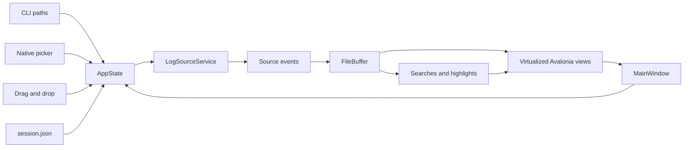

# HexTail architecture

HexTail is a single-process .NET 10 desktop application built with Avalonia
12.1.1. It owns the window, file pickers, drag-and-drop, rendering, tailers,
and persistence locally. There is no browser, WebView, JavaScript runtime, or
HTTP server in the runtime path.

Elastic sources use a dual-endpoint, source-neutral path: Kibana provides
supported data-view metadata and Elasticsearch provides read-only PIT/search
requests, plus the count and preview queries behind the setup flow. Local files and remote sources emit parsed `Line` batches into the
same buffer, search, inspector, and virtualized renderer. Secrets use the native
credential vault and are excluded from session JSON.

## Runtime flow

1. `Program` creates the Avalonia desktop lifetime and registers the Material
   Design icon provider.
2. `App` applies the dark Cyber Tail theme and creates `MainWindow` with the
   command-line paths.
3. `AppState` restores session data, opens each path, and owns the selected
   file, settings, searches, and window state.
4. `TailerService` starts one `FileTailer` per file, each given a
   `TimestampingParser` that wraps the file's parser and stamps every parsed
   line on the tailer thread. Tailers publish immutable events for new lines,
   truncation, rotation, and missing-file recovery.
5. `AppState` drains events on the UI dispatcher, appends parsed lines to the
   bounded `FileBuffer`, updates searches, and notifies the view models.
6. Virtualized `ListBox` controls render only the visible log rows, and a
   structured source's cells are computed only for those rows; the inspector's context list shows a small window of rows.
   Closing the window saves state and disposes the tailers.
7. A merged stream is a tab with no tailer of its own. `AppState.DrainTailerEvents`
   routes each member's drained lines to every open stream that merges that
   member: `StreamMerger` releases them in timestamp order and the released
   lines are appended to the stream tab's `FileBuffer`, from which the views,
   filters and inspector work as for any other source (see below).

## Component map

| Area | Source | Responsibility |
| --- | --- | --- |
| Application shell | `src/HexTail/MainWindow.axaml` | Commands, tabs, search controls, follow toggle, inspector and settings panes; the Elastic setup page is shown in the workspace area while open |
| State | `src/HexTail/Application/AppState.cs` | Open files, selected file, settings, searches, persistence coordination |
| File state | `src/HexTail/Application/FileTabState.cs` | One file buffer, derived views, follow state, selected line (`SelectedLine`), bookmarks (`Bookmarks`), the source's optional `ColumnLayout` |
| Streams | `src/HexTail/Application/StreamState.cs`, `src/HexTail/Domain/StreamMerger.cs` | `StreamState`: a stream's definition, its merger, which members are open or missing, hidden sources and time range. `StreamMerger`: the pure watermark merge |
| Columns | `src/HexTail/Application/ColumnLayout.cs` | `ColumnLayout` (columns, widths, composed rows, time display), per-source defaults and `MessageField` |
| Domain | `src/HexTail/Domain/` | Lines, bounded buffers, parsers, `TimestampDetector` and `TimestampingParser`, search compilation, highlight ranges |
| Tailing | `src/HexTail/Tailing/` | Background file monitoring and resilient tail events |
| Views | `src/HexTail/Views/` | Native Avalonia log rows, `TimelineHistogram` and `OverviewRuler` (with `CoalescedRebuild`), search tabs, inspector panel, `ColumnHeaderBar` (column titles, resize handles, Columns menu), settings controls (Appearance and Limits only), and `ElasticSetupPage`, the five-step Elastic setup page shown in the workspace area while the sidebar and status bar stay |
| View models | `src/HexTail/ViewModels/` | Window, settings and per-view state; `StreamEditorViewModel` is the sidebar's create/edit stream editor and `SourceChipViewModel` a per-source toggle in a stream's filter bar; `InspectorViewModel` owns the inspector (open state, width, fields, context list) and toggles bookmarks on the selected row; `ColumnHeaderViewModel` backs the column header and menu and `LogLineViewModel` builds a row's cells; `ElasticSetupViewModel` drives the Elastic setup flow (see below) |
| Elastic | `src/HexTail/Elastic/` | Kibana and Elasticsearch clients (`IElasticApiClient`), tailer, health monitor, and the setup helpers `CloudId`, `Rison` and `DiscoverUrlImport` |
| Persistence | `src/HexTail/Persistence/` | Atomic JSON session load/save and persisted configuration types |
| Tests | `src/HexTail.Tests/` | Domain, tailing, persistence, view-model, and headless UI coverage |

## Important behavior

- `.logfmt` paths use `LogfmtParser`, `.jsonl` paths use `JsonlParser`, and every
  other extension uses `PlainTextParser`.
- `JsonlParser` preserves raw JSONL text and exposes flattened object leaf fields;
  malformed or non-object lines remain plain text.
- `Line.Timestamp` is a `DateTimeOffset?` and `Line.TimestampInherited` marks a
  line that took the previous line's time. `TimestampDetector` reads well-known
  fields (ISO or Unix s/ms/us/ns) and ISO-8601, common-log and syslog prefixes;
  a zone-less time is read in the zone supplied when the line is parsed (the
  display zone). `TimestampingParser` fixes one strategy per source from its
  first timestamped line, lets untimestamped lines inherit the previous one, and
  forgets the strategy after 200 consecutive misses. Elastic hits carry their
  document timestamp.
- Structured sources (JSONL, logfmt, Elastic) render as cells. A source's
  `ColumnLayout` (columns, widths, composed rows, absolute or relative time) is
  held on `FileTabState` and persisted as optional fields on the file and
  Elastic tab configs; when absent, `ColumnLayout.DefaultFor` supplies Time |
  Level | Message (Elastic: Time | Level | the view's output fields). Layout
  changes go through `AppState.SetColumnLayoutAsync`, which rolls back if the
  save fails. Plain text, and composed rows, keep the single text row.
  `LogLineViewModel` builds a row's `LogCellViewModel` cells (time, level,
  message or field, with per-cell highlight spans) only when the row is
  realized; `ColumnHeaderViewModel` and `ColumnHeaderBar` drive the header,
  resize drags and the Columns menu, and the inspector's field menu can add a
  column.
- Every `Line` carries an optional `SourceId` (the file tab or Elastic source it
  came from): `TimestampingParser` stamps it for files and `ElasticTailer` for
  Elastic hits. Nothing but merged streams reads it.
- A stream (`StreamSettings`: id, name, ordered members keyed `file:{path}` or
  `elastic:{source id}`, each with a colour) is a `FileTabState` whose
  `LogSourceKind` is `Stream`, with a `NullTailer` and a `StreamState`. Its
  members are the tabs that are open; the rest are listed as missing.
  `StreamMerger` is a pure, single-threaded watermark merge: each member has a
  FIFO queue, and a line is released when its timestamp is at or below the
  smallest newest timestamp of the members that delivered recently, or when it
  has waited longer than the 5 s hold (`StreamMerger.DefaultHold`). Release order is
  (timestamp, member order, arrival). A line released older than one already
  released goes into the merger's late set (`IsLate`), which the views read
  for the clock marker, the Time-cell tooltip and the inspector's Source line.
  A line without a timestamp takes its member's previous key. AppState's lock
  guards every merger call. A member's `SourceReset` (truncation, rotation,
  Elastic reload or range change) flags its streams for rebuild: the stream
  buffer is cleared and every member's current buffer is merged again, which
  also clears the stream's selection and bookmarks.
- A stream renders as columns (`ColumnLayout.DefaultFor` gives Time | Source |
  Level | Message) and has its own rules, level mask, searches and column
  layout. Per-source hide toggles and the time range live on `StreamState`;
  `AppState.SetStreamTimeRange` forwards the range to each open Elastic member
  (`SetElasticTimeRange`) and filters file members' rows by timestamp in the
  stream's view (rows without a timestamp and Elastic rows always pass).
- Stream definitions persist as `AppConfig.Streams`, open streams as
  `AppConfig.OpenStreams` (`PersistedStreamTab`: hidden sources and range) with
  `SelectedStreamId`; streams are restored after the files and Elastic sources.
- The timeline histogram and overview ruler are drawn by two Avalonia controls
  (`TimelineHistogram` above the column header, `OverviewRuler` in a 10 px column
  beside the log list) from one `LogOverviewViewModel` per `LogViewViewModel`
  (`LogViewViewModel.Overview`). The data is built by two pure functions in
  `Domain`. `TimeHistogram.Build` buckets the displayed rows (rows with a
  timestamp only) on the smallest "nice" interval of `TimeHistogram.Intervals`
  that fits the bucket budget (whole weeks past 7 d), aligned in the display zone,
  and records per-level counts and the first row of each bucket; it returns null
  when no row has a time. `ScrollMarkers.Build` returns a `ScrollMarker` (row,
  rule colour, error) for each row that matches a rule or is an error. Neither
  touches Avalonia or the buffer, so both are tested directly.
- `LogOverviewViewModel` adapts them to a view. `Invalidate` runs on every sync of
  the view: it bumps `Version` and rescans the displayed rows for a timestamp to
  set `HasTimeline` (which shows or hides the histogram panel); `HasRows` shows
  the ruler. `BuildMarkers` resolves a row's rule colour from the tab's searches
  (a search view skips its own) and then the first highlight rule of
  `EffectiveRules`; colours looked up through the rules are cached per `Line`
  and discarded when the `RuleSet` instance changes. It also holds bucket
  descriptions and jumps (`JumpToBucket`, `JumpToFraction` select a row through
  `LogViewViewModel.SelectRowOf`; a bucket click selects the row the histogram was
  built for, by reference, so a build up to 250 ms old cannot jump to the wrong
  row while tailing). The histogram's collapsed state is
  `MainWindowViewModel.TimelineOpen`, saved as `AppWindowState.HistogramCollapsed`.
  `LogViewViewModel.Sync` calls `LogOverviewViewModel.Refresh`, which bumps
  `Version` only when something a build reads changed (the displayed rows, the
  effective `RuleSet` instance, the searches' result counts and colours, the time
  zone, `HistogramPrior`, `TimeWindow`, `ElasticLoading`), so a sync that changes
  nothing does not make the controls rebuild. `HasTimeline` (the panel's
  visibility) is true when a displayed row has a timestamp, while the tab has a
  `HistogramPrior`, or while an Elastic tab loads, so a range with no rows still
  leaves the panel up to double-click and reset.
- Both controls watch `Version` and rebuild through `CoalescedRebuild`: a request
  starts a 250 ms timer, and when it fires the rebuild runs only if the control
  is visible and laid out (and, for the histogram, not mid-drag). A request that
  arrives while it cannot run stays dirty; Avalonia 12 has no public change
  notification for `IsEffectivelyVisible`, so each control calls
  `CoalescedRebuild.Poke` after every layout pass (and at the end of a drag), and
  the pending rebuild is scheduled once the control can draw. A collapsed
  timeline or a view in a background tab costs no work while rows stream in, and
  a detached control starts no timer.
- A range chosen on the histogram goes through
  `MainWindowViewModel.ApplyHistogramRange`, which routes it by source kind and
  sends the bounds as round-trip ISO strings. A stream gets
  `AppState.SetStreamTimeRange(..., live: false)`; an Elastic tab gets
  `SetElasticTimeRange` (and its input zone is set to the display zone); a file
  tab gets `AppState.SetFileTimeWindow`, which sets `FileTabState.TimeWindow`.
  That window is session-only, and `CreateTimeWindowPredicate` makes
  `LogViewViewModel` drop file rows whose timestamp falls outside it (rows without
  a timestamp pass); the filter bar shows it as a chip with
  `ClearTimeWindowCommand`. Before the first drag, the range in place is stored
  once as `FileTabState.HistogramPrior` (from, to, live, and for Elastic the input
  zone; for a stream, also each open Elastic member's own range and zone as
  `MemberRange`, because a drag re-queries every member and a live stream does
  not touch them on reset). `ResetHistogramRange` restores it (a file tab with no prior clears its
  window, a stream goes live with all rows, an Elastic tab does nothing) and
  clears it. Applying a range from the time pill, **Show all rows**, or the time
  window chip's clear button also clears `HistogramPrior`, making the new range
  the baseline; a stream-wide range (pill, drag, show all rows, reset) also
  clears the member tabs' own priors. A drag whose buckets hold no rows is
  ignored.
- Search results are buffer-relative. When old lines roll out, result indices
  are rebased with the buffer.
- Filter rules (`ViewRule`) have an action (highlight, show only, hide) and a
  scope: global rules live in `AppSettings.Rules`, source rules on the file tab.
  Hide and show-only rules filter the visible log list (the inspector's context
  list ignores them) but do not delete rows from the buffer; highlight rules add match ranges to visible rows.
- Each source also has a level mask (`LogLevels`); lines whose level cannot be
  detected always pass it.
- Saved filters (`AppConfig.SavedFilters`) store source rules plus a level mask
  and are merged into a source on apply.
- The main view and each search view have independent follow-tail state.
- The inspector's context list is a window over the selected buffer line, sized
  by `AppSettings.ContextAbove` and `AppSettings.ContextBelow`; its toggle is
  in-session UI state. The inspector's open state and width are persisted;
  bookmarks live on `FileTabState` for the session only and are not saved.
- The default buffer cap is 100,000 lines per file, controlled by
  `AppSettings.MaxLines`.
- Elastic setup is a five-step page (`ElasticSetupViewModel`, `ElasticSetupPage`):
  Connection, Data view, Filter, Columns, Name & open. It is opened from the
  sidebar, the empty state, or the command palette at the step that fits the
  entry point. The connection (and its keyring secret) is saved on leaving step
  1 through `ElasticConnectionEditorViewModel`; steps 2 to 4 edit an
  `ElasticViewEditorViewModel` in memory, and step 5 saves the source and
  optionally opens it. Closing mid-flow keeps what step 1 saved and drops the
  rest without prompting.
- The setup flow adds two read-only queries to `IElasticApiClient`: `CountAsync`
  (documents matching a filter value over the last 15 minutes, shown as filter
  chip counts) and `PreviewAsync` (the most recent documents with the chosen
  output fields, shown as up to five preview rows). The connection test probes
  Kibana, Elasticsearch and the credentials separately.
- `CloudId` decodes an Elastic Cloud ID into the Kibana and Elasticsearch URLs.
  `Rison` parses the Rison state in a Kibana Discover URL, and
  `DiscoverUrlImport` turns it into a prefill (Kibana origin, data view id,
  columns, and a single `field : value` clause) plus a list of ignored parts;
  the view model applies each part once, when its step is reached, and never
  over a choice the user has made.
- Missing or malformed session JSON is treated as a first launch; atomic saves
  preserve the last good session file.

## Extension points

To add another file parser:

1. Implement `ILogParser` in `src/HexTail/Domain/`.
2. Register the extension in `LogParserSelector.ForPath` in
   `src/HexTail/Application/AppState.cs`.
3. Add parser coverage under `src/HexTail.Tests/Domain/`.

To change a user-visible setting, update the persisted model in
`src/HexTail/Persistence/AppConfig.cs`, normalize it in `AppState`, and
cover round-trip behavior in the persistence or application tests.

## Current boundary

The app tails files that are accessible to the local process. It does not
write log files, collect remote logs, provide an installer, sign binaries,
auto-update, or search unopened files globally. Those are separate features,
not hidden behavior of the current architecture.
