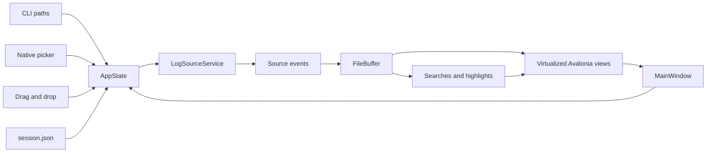

# HexTail architecture

HexTail is a single-process .NET 10 desktop application built with Avalonia
12.1.1. It owns the window, file pickers, drag-and-drop, rendering, tailers,
and persistence locally. There is no browser, WebView, JavaScript runtime, or
HTTP server in the runtime path.

Elastic sources use a dual-endpoint, source-neutral path: Kibana provides
supported data-view metadata and Elasticsearch provides read-only PIT/search
requests, plus the count and preview queries behind the setup flow. Local files and remote sources emit parsed `Line` batches into the
same buffer, search, inspector, and virtualized renderer. Secrets use the native
credential vault and are excluded from session JSON.

## Runtime flow

1. `Program` creates the Avalonia desktop lifetime and registers the Material
   Design icon provider.
2. `App` applies the dark Cyber Tail theme and creates `MainWindow` with the
   command-line paths.
3. `AppState` restores session data, opens each path, and owns the selected
   file, settings, searches, and window state.
4. `TailerService` starts one `FileTailer` per file. Tailers publish immutable
   events for new lines, truncation, rotation, and missing-file recovery.
5. `AppState` drains events on the UI dispatcher, appends parsed lines to the
   bounded `FileBuffer`, updates searches, and notifies the view models.
6. Virtualized `ListBox` controls render only the visible log rows; the inspector's context list shows a small window of rows.
   Closing the window saves state and disposes the tailers.

## Component map

| Area | Source | Responsibility |
| --- | --- | --- |
| Application shell | `src/HexTail/MainWindow.axaml` | Commands, tabs, search controls, follow toggle, inspector and settings panes; the Elastic setup page is shown in the workspace area while open |
| State | `src/HexTail/Application/AppState.cs` | Open files, selected file, settings, searches, persistence coordination |
| File state | `src/HexTail/Application/FileTabState.cs` | One file buffer, derived views, follow state, selected line (`SelectedLine`), bookmarks (`Bookmarks`) |
| Domain | `src/HexTail/Domain/` | Lines, bounded buffers, parsers, search compilation, highlight ranges |
| Tailing | `src/HexTail/Tailing/` | Background file monitoring and resilient tail events |
| Views | `src/HexTail/Views/` | Native Avalonia log rows, search tabs, inspector panel, settings controls (Appearance and Limits only), and `ElasticSetupPage`, the five-step Elastic setup page shown in the workspace area while the sidebar and status bar stay |
| View models | `src/HexTail/ViewModels/` | Window, settings and per-view state; `InspectorViewModel` owns the inspector (open state, width, fields, context list) and toggles bookmarks on the selected row; `ElasticSetupViewModel` drives the Elastic setup flow (see below) |
| Elastic | `src/HexTail/Elastic/` | Kibana and Elasticsearch clients (`IElasticApiClient`), tailer, health monitor, and the setup helpers `CloudId`, `Rison` and `DiscoverUrlImport` |
| Persistence | `src/HexTail/Persistence/` | Atomic JSON session load/save and persisted configuration types |
| Tests | `src/HexTail.Tests/` | Domain, tailing, persistence, view-model, and headless UI coverage |

## Important behavior

- `.logfmt` paths use `LogfmtParser`, `.jsonl` paths use `JsonlParser`, and every
  other extension uses `PlainTextParser`.
- `JsonlParser` preserves raw JSONL text and exposes flattened object leaf fields;
  malformed or non-object lines remain plain text.
- Search results are buffer-relative. When old lines roll out, result indices
  are rebased with the buffer.
- Filter rules (`ViewRule`) have an action (highlight, show only, hide) and a
  scope: global rules live in `AppSettings.Rules`, source rules on the file tab.
  Hide and show-only rules filter the visible log list (the inspector's context
  list ignores them) but do not delete rows from the buffer; highlight rules add match ranges to visible rows.
- Each source also has a level mask (`LogLevels`); lines whose level cannot be
  detected always pass it.
- Saved filters (`AppConfig.SavedFilters`) store source rules plus a level mask
  and are merged into a source on apply.
- The main view and each search view have independent follow-tail state.
- The inspector's context list is a window over the selected buffer line, sized
  by `AppSettings.ContextAbove` and `AppSettings.ContextBelow`; its toggle is
  in-session UI state. The inspector's open state and width are persisted;
  bookmarks live on `FileTabState` for the session only and are not saved.
- The default buffer cap is 100,000 lines per file, controlled by
  `AppSettings.MaxLines`.
- Elastic setup is a five-step page (`ElasticSetupViewModel`, `ElasticSetupPage`):
  Connection, Data view, Filter, Columns, Name & open. It is opened from the
  sidebar, the empty state, or the command palette at the step that fits the
  entry point. The connection (and its keyring secret) is saved on leaving step
  1 through `ElasticConnectionEditorViewModel`; steps 2 to 4 edit an
  `ElasticViewEditorViewModel` in memory, and step 5 saves the source and
  optionally opens it. Closing mid-flow keeps what step 1 saved and drops the
  rest without prompting.
- The setup flow adds two read-only queries to `IElasticApiClient`: `CountAsync`
  (documents matching a filter value over the last 15 minutes, shown as filter
  chip counts) and `PreviewAsync` (the most recent documents with the chosen
  output fields, shown as up to five preview rows). The connection test probes
  Kibana, Elasticsearch and the credentials separately.
- `CloudId` decodes an Elastic Cloud ID into the Kibana and Elasticsearch URLs.
  `Rison` parses the Rison state in a Kibana Discover URL, and
  `DiscoverUrlImport` turns it into a prefill (Kibana origin, data view id,
  columns, and a single `field : value` clause) plus a list of ignored parts;
  the view model applies each part once, when its step is reached, and never
  over a choice the user has made.
- Missing or malformed session JSON is treated as a first launch; atomic saves
  preserve the last good session file.

## Extension points

To add another file parser:

1. Implement `ILogParser` in `src/HexTail/Domain/`.
2. Register the extension in `LogParserSelector.ForPath` in
   `src/HexTail/Application/AppState.cs`.
3. Add parser coverage under `src/HexTail.Tests/Domain/`.

To change a user-visible setting, update the persisted model in
`src/HexTail/Persistence/AppConfig.cs`, normalize it in `AppState`, and
cover round-trip behavior in the persistence or application tests.

## Current boundary

The app tails files that are accessible to the local process. It does not
write log files, collect remote logs, provide an installer, sign binaries,
auto-update, or search unopened files globally. Those are separate features,
not hidden behavior of the current architecture.
